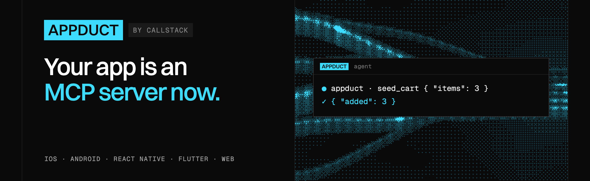

<a href="https://callstackincubator.github.io/appduct/"></a>

# Appduct

[![MIT license][license-badge]][license] [![npm downloads][npm-downloads-badge]][npm-downloads] [![PRs Welcome][prs-welcome-badge]][prs-welcome]

Appduct lets a terminal, a test runner, or an AI agent call functions inside your running iOS, Android, React Native, Flutter or web app. Appduct calls these functions tools. Only the tools you register are reachable.

## Why use Appduct

- **E2E tests skip the setup.** Instead of tapping through login, onboarding and an empty cart, a test calls `log_in` or `seed_cart` and starts at the screen it's testing.
- **Agents can drive your app.** Over MCP or the CLI, an agent can flip a feature flag, open a screen, or read some state through your tools.
- **No extra debug screens.** Register tools for test setup instead of adding menus or buttons to your app.
- **Production builds leave it out by default.** You can opt in for internal builds such as TestFlight; see [Build variants](https://callstackincubator.github.io/appduct/guides/build-variants/).

## How it works

1. **Register tools in your app.** Give each function a name, a description and a handler. Schemas tell callers what inputs and outputs to expect.
2. **Connect the running app.** A connection link pairs it with Appduct on your computer.
3. **Call the tools.** Use the CLI, a test runner or an agent over MCP.

## Getting started

You need Node 20 or newer for the CLI and a development build of your app. Check your SDK's setup guide below for platform requirements.

### 1. Install the CLI

```bash
npm install -g appduct
```

### 2. Add Appduct and register a tool

Follow the setup guide for your platform to install the SDK and configure the connection:

| Platform | SDK and setup |
| --- | --- |
| iOS | [AppductCore](packages/native/ios/README.md), with Swift Package Manager or CocoaPods |
| Android | [Native Android SDK](packages/native/android/README.md), from Maven Central |
| React Native | [@appduct/react-native](packages/react-native/README.md), for Expo development builds or bare apps |
| Flutter | [appduct](packages/flutter/README.md), from pub.dev |
| Web | [@appduct/web](packages/web/README.md), for any framework or plain JavaScript |

The same tool can be registered on each platform:

<details open>
<summary>iOS (Swift)</summary>

```swift
import AppductCore

try Appduct.shared.register(
  name: "seed_cart",
  description: "Fill the cart with test items.",
  inputSchema: ["type": "object", "properties": ["items": ["type": "number"]], "required": ["items"]]
) { args in
  ["added": (args["items"] as? NSNumber)?.intValue ?? 0]
}
```

</details>

<details>
<summary>Android (Kotlin)</summary>

```kotlin
import com.callstack.appduct.Appduct
import org.json.JSONObject

Appduct.register(
  name = "seed_cart",
  description = "Fill the cart with test items.",
  inputSchema = JSONObject("""{"type":"object","properties":{"items":{"type":"number"}},"required":["items"]}"""),
) { args ->
  JSONObject().put("added", args.optInt("items"))
}
```

</details>

<details>
<summary>React Native</summary>

```tsx
import { useAppductTool } from "@appduct/react-native";
import { z } from "zod";

export function AppductTools() {
  useAppductTool({
    name: "seed_cart",
    description: "Fill the cart with test items.",
    inputSchema: z.object({ items: z.number() }),
    outputSchema: z.object({ added: z.number() }),
    handler: async ({ items }) => ({ added: items }),
  });

  return null;
}
```

Mount `<AppductTools />` near your app's root.

</details>

<details>
<summary>Flutter (Dart)</summary>

Register after `Appduct.ensureInitialized()` in your app startup code.

```dart
import 'package:appduct/appduct.dart';

Appduct.instance.registerTool(
  'seed_cart',
  description: 'Fill the cart with test items.',
  inputSchema: {
    'type': 'object',
    'properties': {'items': {'type': 'number'}},
    'required': ['items'],
  },
  handler: (args, context) => {'added': (args['items'] as num).toInt()},
);
```

</details>

<details>
<summary>Web</summary>

```ts
import { registerTool } from "@appduct/web";

registerTool({
  name: "seed_cart",
  description: "Fill the cart with test items.",
  inputSchema: {
    type: "object",
    properties: { items: { type: "number" } },
    required: ["items"],
  },
  handler: async ({ items }) => ({ added: items }),
});
```

</details>

### 3. Connect and call the tool

With your app running, choose one connection method. Run the command from your app's project directory, using the scheme configured in its setup guide:

| Target | Command |
| --- | --- |
| iOS Simulator | `appduct sessions link --open ios-sim` |
| Android emulator or USB device | `appduct sessions link --open android --app-id com.example.shop` |
| Physical iOS or Android device | `appduct sessions link --qr` |
| Web page | `appduct sessions link --open web http://localhost:5173/` |

For Android, replace `com.example.shop` with your installed build's app id. For a physical device, scan the QR code on the same local network as your computer. For Web, open the URL the CLI prints. See [Connect a device](https://callstackincubator.github.io/appduct/guides/cli/#connect-a-device) for other options.

Once connected, list the tools and call the one you registered:

```bash
appduct tools ls
appduct tools call seed_cart --input '{"items":3}'
```

The example returns `{"added":3}`. Replace its handler with your app's cart setup.

## Try a playground

Try a complete example before adding Appduct to your own app. Each playground registers the same five demo tools and the `playground_ping` event:

- [iOS](playground-native/ios/README.md): SwiftUI
- [Android](playground-native/android/README.md): Jetpack Compose
- [React Native](playground/README.md): Expo
- [Flutter](playground-flutter/README.md): Android, iOS and macOS
- [Web](playground-web/README.md): React and Vite

## Learn more

- [Use the CLI](packages/appduct/README.md): connect, find tools and watch events
- [Connect an agent](https://callstackincubator.github.io/appduct/guides/agents/): MCP configuration and the agent skill
- [Call tools from tests](packages/appduct/README.md#test-runners-appductclient): the `appduct/client` API
- [Write tools](https://callstackincubator.github.io/appduct/guides/writing-tools/): schemas, long-running tools and events
- [Choose build variants](https://callstackincubator.github.io/appduct/guides/build-variants/): which builds include Appduct
- [Configure security](https://callstackincubator.github.io/appduct/guides/security/): trust, policy and key rotation

## License

[MIT](https://github.com/callstackincubator/appduct/blob/main/LICENSE). Made at [Callstack](https://callstack.com/).

[license-badge]: https://img.shields.io/npm/l/appduct?style=for-the-badge
[license]: https://github.com/callstackincubator/appduct/blob/main/LICENSE
[npm-downloads-badge]: https://img.shields.io/npm/dm/appduct?style=for-the-badge
[npm-downloads]: https://www.npmjs.com/package/appduct
[prs-welcome-badge]: https://img.shields.io/badge/PRs-welcome-brightgreen.svg?style=for-the-badge
[prs-welcome]: https://github.com/callstackincubator/appduct/pulls
